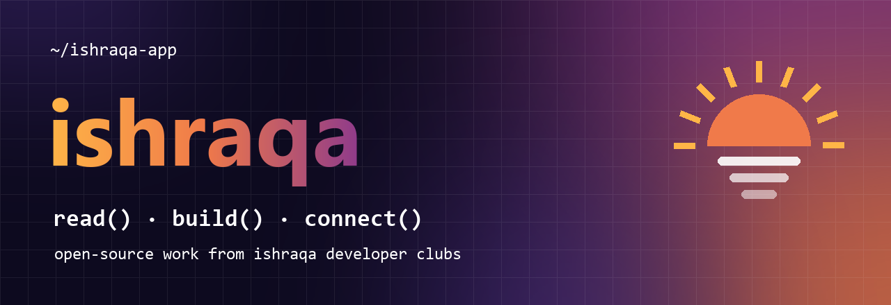

<p align="center"></p>

[](https://ishraqa.app)

# ishraqa

[](https://doi.org/10.5281/zenodo.23737414)

**Ishraqa Daily (إشراقة يومية) in your terminal.** Start the day with the daily quote, the phenomenon of the day and the article of the day. If you are in a developers club, you can also check your team's board and post your weekly standup without leaving the shell.

```sh
npx ishraqa
```

> **Member commands need an Ishraqa developer account.** That means an Ishraqa Daily account that is a member of at least one developers club, or that takes part in the developers hub (linked GitHub, solved challenges, mentoring or a team project). Get the app at <https://ishraqa.app>.
> Every command except `login`, `logout` and `whoami` requires an Ishraqa account that belongs to the developers community (a developers club in the app).

## Install

Needs Node.js 18.17 or newer. No other dependencies.

```sh
npx ishraqa            # run once, nothing to install
npm i -g ishraqa       # or keep it around
```

## Usage

```text
ishraqa <command> [options]

Commands
  today           Today's quote, phenomenon and article
  phenomenon      Today's phenomenon in full (--tomorrow for the teaser)
  login           Sign in with a 6-digit email code
  whoami          Your account and developer access
  clubs           Your developer clubs
  tasks [club]    The club's project board (--mine, --project <id>)
  standup [club]  Post your weekly standup (done / next / blockers)
  logout          Sign out on this machine

Options
  --en / --ar     Interface language (default: your system locale)
  --json          Machine-readable output
  --no-color      Plain output (NO_COLOR is honoured too)
  -h, --help      Show this help
  -v, --version   Show the version
```

Running `ishraqa` with no command is the same as `ishraqa today`.

### `ishraqa today`

```text
  ☀  Ishraqa Daily  ·  Thursday, October 15

╭─ Ishraqa of the day ─────────────────────────────────────────────────────────╮
│ "Work in silence, and let your success make the noise."                      │
│ https://ishraqa.app/q/269/                                                   │
╰──────────────────────────────────────────────────────────────────────────────╯
╭─ Phenomenon of the day ──────────────────────────────────────────────────────╮
│ 🏜️ The Sahara was green… with lakes and hippos                               │
│ Just thousands of years ago, the world's largest hot desert was green        │
│ plains, with a lake bigger than the Caspian Sea.                             │
│ ishraqa phenomenon                                                           │
╰──────────────────────────────────────────────────────────────────────────────╯
╭─ Article of the day ─────────────────────────────────────────────────────────╮
│                   رسالة "مبروك ربحت!": كيف تكشف رسائل الاحتيال قبل أن تخدعك؟ │
│  رسائل الاحتيال أصبحت أذكى، لكن لها علامات ثابتة. تعلّمها مرة واحدة واحمِ نفسك │
│                                                                       وأهلك. │
│                                                     فريق إشراقة · 3 min read │
│ https://ishraqa.app/a/spot-phishing-messages                                 │
╰──────────────────────────────────────────────────────────────────────────────╯
```

The daily quote is the same one everyone sees in the app that day.

### `ishraqa phenomenon`

The whole story: hook, body, quick facts, why it matters, the community poll and questions to talk about.

```text
╭─ Phenomenon of the day · 2026-10-15 ─────────────────────────────────────────╮
│ 🏜️ The Sahara was green… with lakes and hippos                               │
│                                                                              │
│ Just thousands of years ago, the world's largest hot desert was green        │
│ plains, with a lake bigger than the Caspian Sea.                             │
├──────────────────────────────────────────────────────────────────────────────┤
│ From roughly 14,500 to 5,000 years ago, North Africa experienced what        │
│ scientists call the "African Humid Period." …                                │
├──────────────────────────────────────────────────────────────────────────────┤
│ Quick facts                                                                  │
│ ◆ The humid period lasted from about 14,500 to 5,000 years ago               │
│ …                                                                            │
╰──────────────────────────────────────────────────────────────────────────────╯
```

`ishraqa phenomenon --tomorrow` shows only the teaser:

```text
╭─ Tomorrow · 2026-10-16 ──────────────────────────────────────────────────────╮
│ 🧠 Scientific discovery reshapes…                                            │
│ Opens tomorrow in Ishraqa Daily.                                             │
╰──────────────────────────────────────────────────────────────────────────────╯
```

### `ishraqa login`

Sign-in uses a one-time code sent to the email of your existing Ishraqa account. The CLI never creates accounts and never asks for a password.

```text
$ ishraqa login
Email of your Ishraqa account: you@example.com
✉ A 6-digit code is on its way to you@example.com.
Code: 482 913
✔ Signed in as Amna.
developer clubs: 2
```

If the account is not part of the developers' world yet, the CLI says so, keeps nothing on disk and points you to the app:

```text
╭─ Developers only ────────────────────────────────────────────────────────────╮
│ The Ishraqa CLI is for members of the developers' world. Join a developers   │
│ club (or take part in the developers hub) in the Ishraqa Daily app, then run │
│ `ishraqa login` again.                                                       │
│                                                                              │
│ Get the app: https://ishraqa.app                                             │
╰──────────────────────────────────────────────────────────────────────────────╯
```

### `ishraqa clubs`

```text
╭─ ⌨ My developer clubs ───────────────────────────────────────────────────────╮
│ 1. Open Source Circle ★                                                      │
│ lead  ·  14 members  ·  6 open · 3 done this week                            │
├──────────────────────────────────────────────────────────────────────────────┤
│ 2. Mobile Builders                                                           │
│ member  ·  9 members  ·  11 open · 0 done this week                          │
╰──────────────────────────────────────────────────────────────────────────────╯
```

### `ishraqa tasks [club]`

Pick a club by number, by part of its name, or leave it out when you are in only one. The board shows the team's current project; `--mine` keeps the tasks assigned to you or waiting for your review.

```text
╭─ Open Source Circle · Ishraqa CLI ───────────────────────────────────────────╮
│ ○ To do  2                                                                   │
│   • Shell completions for bash and zsh                                       │
│     @Musa  ·  #cli #dx  ·  due 2026-10-20                                    │
│   • Windows installer notes                                                  │
├──────────────────────────────────────────────────────────────────────────────┤
│ ◐ Doing  1                                                                   │
│   • Standup command                                                          │
│     @Amna  ·  #cli                                                           │
├──────────────────────────────────────────────────────────────────────────────┤
│ ◑ In review  0                                                               │
│   Nothing here yet.                                                          │
├──────────────────────────────────────────────────────────────────────────────┤
│ ● Done  7                                                                    │
│   • Login with email code                                                    │
│   +2 more done                                                               │
╰──────────────────────────────────────────────────────────────────────────────╯
```

### `ishraqa standup [club]`

Answers three questions and posts your weekly standup to the club. Posting again in the same week updates it. For scripts, pass the answers as flags:

```sh
ishraqa standup "Open Source" --done "Shipped login" --next "Board filters" --blockers "" --yes
```

### `ishraqa whoami` / `ishraqa logout`

```text
Name      Amna
Username  @amna
Email     amna@example.com
Access    ✔ developer
Clubs     Open Source Circle, Mobile Builders
Hub       GitHub linked, challenges solved
```

## Language and Arabic text

The interface speaks English and Arabic. It follows `--en` / `--ar`, then the `ISHRAQA_LANG` environment variable, then your system locale.

Arabic content is shown as written and right-aligned inside the boxes. How well it reads depends on your terminal's right-to-left support: terminals that shape and reorder Arabic (for example GNOME Terminal/VTE, Konsole, mintty and recent Windows Terminal builds) look best. If yours does not, `--en` gives you English wherever an English version exists.

## Scripting

Every content command accepts `--json`:

```sh
ishraqa today --json | jq -r '.quote.quote'
ishraqa tasks --json | jq '.tasks[] | select(.status == "doing") | .title'
```

Exit codes: `0` ok, `1` error, `2` usage, `3` not a developer account, `4` signed out.

## Privacy and security

- The CLI talks to Ishraqa only, using the public client key that every Ishraqa client ships with and **your own session**. It never holds any privileged key.
- Everything you can see or change is checked again on the server; the developer check in the CLI is a friendly early message, not the protection.
- Your session is stored in `~/.config/ishraqa/session.json` (or `$XDG_CONFIG_HOME/ishraqa/`) with `0600` permissions. Only the access token, refresh token, expiry, user id and email are kept. Tokens refresh automatically. `ishraqa logout` revokes the session and deletes the file.
- Environment: `NO_COLOR`, `FORCE_COLOR`, `ISHRAQA_LANG`, `ISHRAQA_ASCII=1` (ASCII borders), `ISHRAQA_DEBUG=1` (stack traces).

## Contributing

See [CONTRIBUTING.md](CONTRIBUTING.md). Questions: hello@ishraqa.app.

## License

[MIT](LICENSE)
